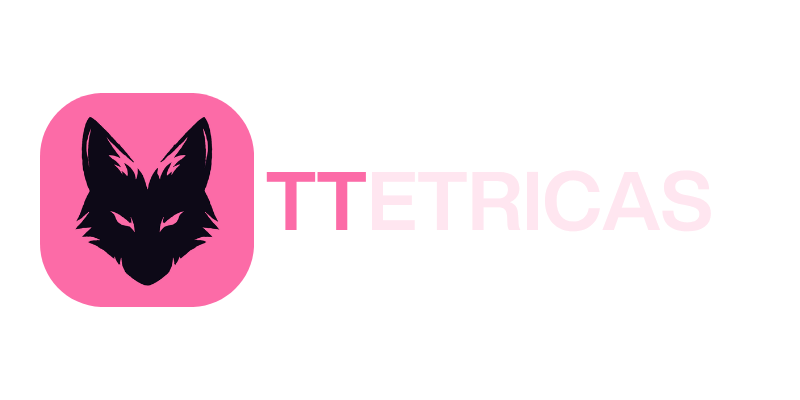

## 

### oh hi, you found me.

coding stuff, making a mess  
and pretending everything is intentional.

  

  

### ✦ things i use to make stuff

 

### ✦ my little toolbox

 

### ✦ find me around

 

  

  

 

  <i>anyway, look around. ♡</i>

<!-- Proudly created with GPRM ( https://gprm.itsvg.in ) -->
